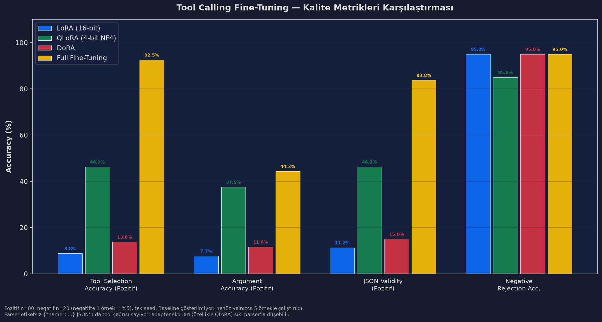
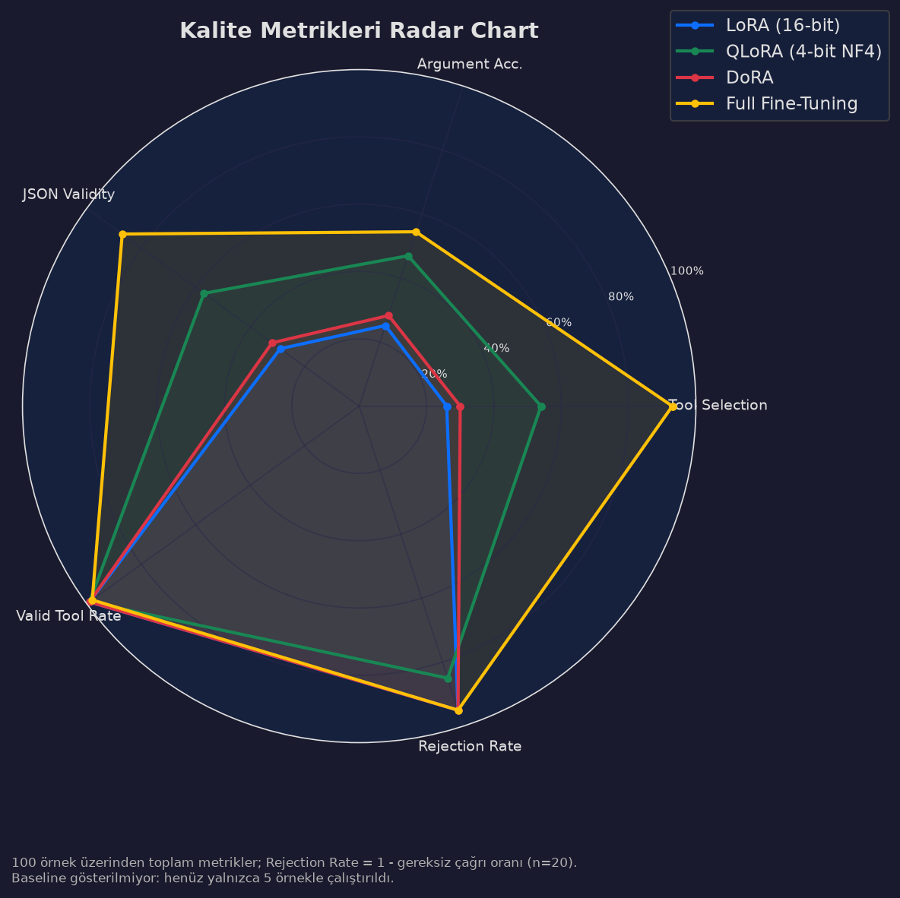
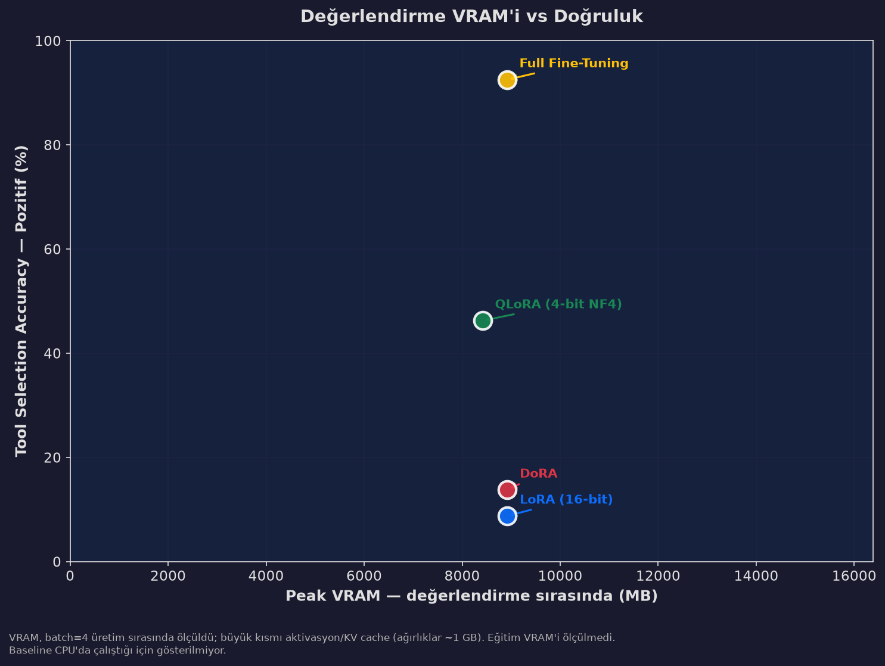
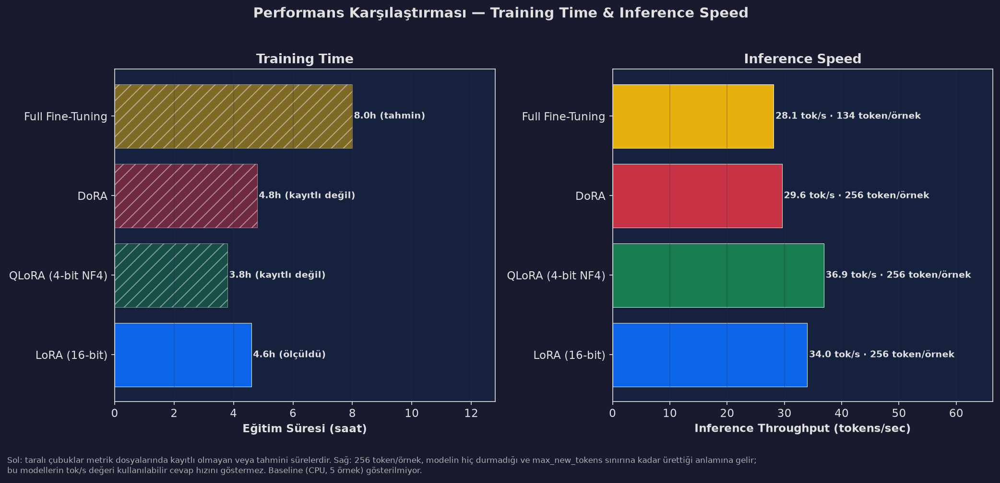
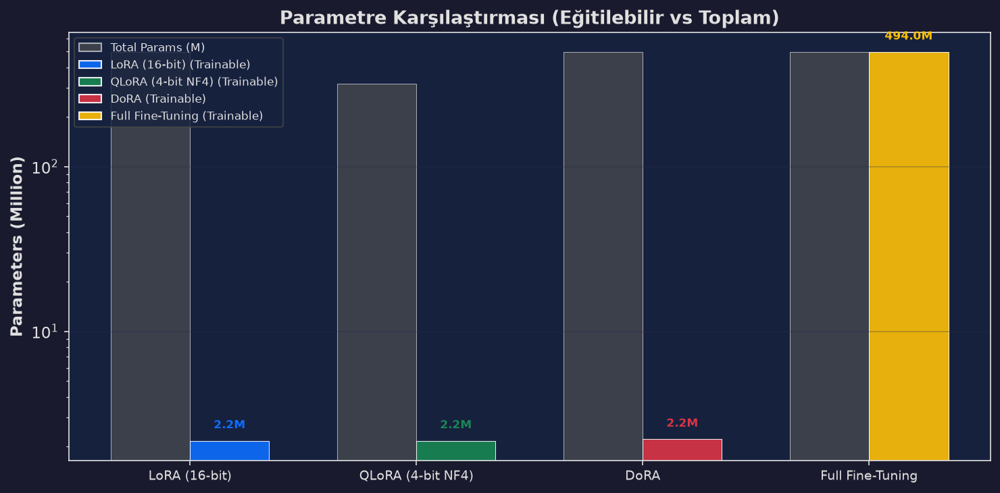

<div align="center">

# 🛠️ Tool Calling Fine-Tuning Benchmark

<p align="center">
  <b>LLM Tool Calling için Kapsamlı ve Yeniden Üretilebilir Fine-Tuning Benchmark Platformu</b><br>
  <b>Systematic Benchmark for LoRA, QLoRA, DoRA & Full Fine-Tuning on Tool Calling</b>
</p>

<!-- Technology Badges - Row 1: Core Runtime & Deep Learning Frameworks -->
[](https://www.python.org/)
[-EE4C2C?style=for-the-badge&logo=pytorch&logoColor=white)](https://pytorch.org/)
[](https://huggingface.co/)
<br>
<!-- Technology Badges - Row 2: Optimization, PEFT & Training Engine -->
[](#experimental-design)
[](https://github.com/bitsandbytes-foundation/bitsandbytes)
[](https://github.com/huggingface/trl)
<br>
<!-- Technology Badges - Row 3: Target Models, Benchmark Harness & Tooling -->
[](#models)
[](#evaluation)
[](#benchmark-results-qwen25-05b)
[](https://github.com/astral-sh/uv)

<br><br>

**[🇬🇧 English](#english) • [🇹🇷 Türkçe](#türkçe)**

</div>

---

<a name="english"></a>

# 🇬🇧 English

A systematic benchmark for comparing parameter-efficient and full fine-tuning methods on LLM-based tool calling.

## Overview

This project evaluates how different fine-tuning strategies affect a language model's ability to select tools, generate valid arguments, and produce reliable structured tool calls.

The benchmark compares:

* **LoRA**
* **QLoRA**
* **DoRA**
* **Full Fine-Tuning**

The same datasets, evaluation pipeline, and task definitions are used across experiments to ensure a fair comparison.

## Models

The benchmark is designed to support multiple open-weight language models.

Initial experiments can include lightweight models such as:

* Qwen2.5-0.5B
* Qwen2.5-1.5B
* SmolLM2
* Other compatible open-weight models

Using multiple model sizes allows the project to investigate how fine-tuning methods behave across different model capacities.

## Dataset

The benchmark uses function-calling data containing both:

* Requests that require a tool call
* Requests where no tool should be called

The data is transformed into a standardized format containing the user request, available tool schemas, expected tool selection, and expected arguments.

## Evaluation

A reusable evaluation harness measures both model quality and system-level efficiency.

### Quality Metrics

* **Tool Selection Accuracy** — whether the correct tool is selected
* **Argument Accuracy** — field-level exact match of generated arguments
* **JSON Validity Rate** — percentage of syntactically valid tool-call outputs
* **Invalid Tool Call Rate** — malformed or unsupported tool calls
* **Unnecessary Tool Call Rate** — tool calls made when no tool was required

### Performance Metrics

* Training time
* Peak VRAM usage
* Trainable parameter count
* Inference latency
* Generation throughput (tokens/sec)

The evaluation pipeline is independent from the training implementation, allowing it to be reused for future experiments.

## Benchmark Results & Empirical Analysis (Qwen2.5-0.5B)

> **Experimental Environment:**
> - **Base Model:** `Qwen/Qwen2.5-0.5B` (Causal Base Language Model, non-instruct)
> - **Fine-Tuning Dataset:** `NousResearch/hermes-function-calling-v1` (1,893 positive examples + 250 synthetic negative rejection samples)
> - **Evaluation Set:** 100 balanced holdout samples (80 tool-required / 20 negative rejection)
> - **Hardware:** Single NVIDIA Tesla T4 GPU (16 GB VRAM) — Google Colab
> - **Runs:** One training run per method (seed 42), no repeated seeds or confidence intervals. See [Limitations](#limitations).

---

### 1. Quality & Output Reliability Analysis

The benchmark measures tool invocation capabilities across four essential dimensions: correct tool selection, field-level argument exact match, strict JSON syntax compliance, and the ability to refrain from calling tools when unnecessary (negative rejection).

| Method | Tool Selection (Pos, n=80) | Arg. Accuracy (Pos) | JSON Validity (Pos) | Neg. Rejection (n=20) | Overall Accuracy |
|:---|:---:|:---:|:---:|:---:|:---:|
| **Baseline (0-shot)** | —† | —† | —† | —† | —† |
| **LoRA (16-bit)** | 8.75% | 7.71% | 11.25% | 95.0% | 26.0% |
| **DoRA (Directional)** | 13.75% | 11.63% | 15.00% | 95.0% | 30.0% |
| **QLoRA (4-bit NF4)** | 46.25%‡ | 37.48% | 46.25%‡ | 85.0% | 54.0% |
| **Full Fine-Tuning** | **92.50%** 🏆 | **44.33%** 🏆 | **83.75%** 🏆 | **95.0%** | **93.0%** 🏆 |

*† The baseline has **not** been evaluated on the 100-sample eval set. It was only run on a 5-sample smoke test (2 tool / 3 no-tool, on CPU — [`reports/baseline_metrics.json`](reports/baseline_metrics.json)): 0/2 correct tool calls, 3/3 correct rejections. Numbers shown here earlier were extrapolated, not measured. **TODO:** re-run `scripts/run_baseline.py` on the full `eval_subset.jsonl` on the same T4 GPU.*

*‡ The parser also counts bare `{"name": ...}` JSON objects without `<tool_call>` tags as tool calls. Many QLoRA outputs are of this form (e.g. `�\n{"name": "find_astronomy_apps", ...}` followed by garbage), so its score would be lower under a strict, tag-only parser. See [Limitations](#limitations).*

#### 📊 Per-Metric Quality Comparison Across Positive & Negative Sets

Below is the comparative breakdown of model performance on positive tool calling capabilities versus false-positive suppression:

<p align="center">
  
</p>

> **Key Takeaway:** In this setup, Full Fine-Tuning was the only method that reliably learned the structured output format on the 0.5B model, reaching **92.5%** tool selection and **83.8%** valid JSON. The adapters were applied to attention layers only (`q/k/v/o_proj`, r=16), and in that configuration they did not learn the format reliably. Whether LoRA on all linear layers (MLP included) closes the gap was not tested.

#### 🕸️ 5-Axis Behavioral Capability Profile

To assess model balance across all functional dimensions, we plot a normalized 5-axis radar chart incorporating tool selection, argument accuracy, JSON syntax, rejection safety, and avoidance of invalid tool names:

<p align="center">
  
</p>

> **Key Takeaway:** QLoRA covers a larger area than LoRA/DoRA, and Full Fine-Tuning covers nearly the whole polygon while keeping 95.0% negative rejection. Note that the rejection axis rests on only 20 negative samples (95% = 1 error, 85% = 3 errors).

---

### 2. Efficiency: Compute, Memory & Throughput

> ⚠️ **Read this table with care.** These numbers come from the evaluation run (batch size 4, `max_new_tokens=256`), not from training. Most of the differences between methods reflect output behaviour and weight storage, not the fine-tuning methods themselves. Details below the table.

| Method | Peak VRAM (Eval) | Generation Speed | Latency | Generated Tokens (100 samples) | Trainable Weights | Checkpoint Footprint |
|:---|:---:|:---:|:---:|:---:|:---:|:---:|
| **Baseline** | N/A (CPU, 5 samples) | 9.78 tok/s | 26,175 ms | 1,280 (5 samples) | 0 (0.0%) | 988 MB |
| **LoRA** | 8,922 MB | 34.00 tok/s | 7,528 ms | 25,600 (always 256) | 2.16M (0.43%) | ~8.5 MB adapter |
| **DoRA** | 8,922 MB | 29.60 tok/s | 8,649 ms | 25,600 (always 256) | 2.21M (0.45%) | ~8.7 MB adapter |
| **QLoRA** | 8,416 MB | 36.89 tok/s | 6,939 ms | 25,600 (always 256) | 2.16M (0.43%) | ~8.5 MB adapter |
| **Full FT** | 8,914 MB | 28.13 tok/s | **4,752 ms** | 13,368 | 494M (100.0%) | 988 MB full weights |

* **Throughput and latency:** LoRA, DoRA and QLoRA generated exactly 256 tokens for every sample. They never emitted `<|im_end|>`, so they kept generating until the token limit, typically producing repetitive garbage (`sourceMapping`, `ToInt`, …) after the answer. Their tok/s values describe that runaway generation and should not be used to rank the methods by speed. Full FT learned to stop, which is why it has the lowest latency per sample.
* **Peak VRAM:** This is `torch.cuda.max_memory_allocated()` during batched generation over prompts of up to ~2k tokens. Activations, KV cache and logits dominate it; the model weights are only ~1 GB. The ~500 MB QLoRA difference is roughly the size saving of 4-bit weights. **Training VRAM**, where QLoRA's main advantage would show, was not recorded.
* The baseline row was run on CPU with 5 samples and cannot be compared to the other rows.

#### 📈 VRAM vs. Accuracy Pareto Frontier

Evaluating the trade-off between peak memory utilization and positive tool selection accuracy:

<p align="center">
  
</p>

> **Key Takeaway:** Eval-time VRAM is nearly the same for all methods (8.4–8.9 GB) because activations dominate it, so this chart mainly separates the methods on accuracy. Full FT roughly doubles QLoRA's tool selection at about the same inference memory. The chart says nothing about training memory.

#### ⏱️ Training Time vs. Inference Throughput

Examining the relationship between total training time (GPU hours on Tesla T4) and runtime token throughput:

<p align="center">
  
</p>

> **Key Takeaway:** Only LoRA's training time is recorded in the metrics files (4h 36m, [`reports/lora_metrics.json`](reports/lora_metrics.json)). The QLoRA (~3h 48m) and DoRA (~4h 50m) values are not stored in `reports/*_metrics.json`, and the Full FT value (~8h) is an estimate. The throughput side of this chart is affected by the runaway-generation issue described above: higher tok/s for the adapters does not mean faster useful answers. Full FT has the lowest latency per sample (4,752 ms) because it stops after the tool call.

#### ⚖️ Parameter Allocation (Trainable vs. Frozen Backbone)

Visualizing the scale of parameter updates across methods on a logarithmic scale:

<p align="center">
  
</p>

> **Key Takeaway:** The adapters update ~2.16M parameters (0.43%), and only in attention projections. In this setup that was not enough to make the 0.5B model emit `<tool_call>` blocks reliably, while updating all 494M parameters was. Whether a larger adapter budget (higher rank, or MLP layers included) would be enough was not tested.

---

### 3. Key Findings

1. **Full Fine-Tuning clearly won in this setup (92.5% vs. at most 46.25%):**
   Full FT updates every layer, including the MLP blocks; the adapters touched only attention projections. The gap is large enough to be meaningful even with n=80. It is a comparison against *attention-only, r=16* adapters, though, not against PEFT in general.
2. **QLoRA beat LoRA (46.25% vs 8.75%), but the cause is unknown:**
   The two runs should differ only in 4-bit quantization, yet a 5x gap is unusually large. Other differences between the runs are possible: the QLoRA notebook used `bnb_4bit_compute_dtype: float16` while `configs/qlora.yaml` says `bfloat16`, and LoRA took longer to train than QLoRA, which is the reverse of what is usually expected. With a single seed, this result does not support the claim that "quantization acts as regularization". It should be re-checked before any explanation is attached to it. Part of QLoRA's score also comes from the lenient parser (bare JSON without `<tool_call>` tags).
3. **DoRA was slightly better than LoRA (13.75% vs 8.75%):**
   That is 11 vs 7 correct samples out of 80, a 4-sample difference from a single run. It is within what run-to-run noise could produce, so it is not evidence of a real DoRA advantage.
4. **Negative rejection was 85–95%, but not hallucination-free:**
   Fine-tuning did not cause heavy over-triggering. Still, LoRA, DoRA and Full FT each made an unnecessary tool call on 1 of 20 negative prompts (5%), and QLoRA on 3 of 20 (15%). The negatives are also built from a small fixed pool of question templates shared between train and val, so this score may partly reflect memorization (see [Limitations](#limitations)).

> 📊 Per-method details and error analysis: [reports/final_benchmark_report.md](reports/final_benchmark_report.md)

## Experimental Design

The benchmark investigated the following questions:

* Can parameter-efficient fine-tuning achieve performance comparable to Full Fine-Tuning? → **Not in this setup.** Attention-only r=16 adapters reached at most half of Full FT's tool selection. All-linear LoRA was not tested.
* How much VRAM can QLoRA save compared with LoRA? → **Not measured.** Training VRAM was not recorded. At evaluation time the difference was ~500 MB, roughly the 4-bit weight saving.
* Does DoRA provide measurable improvements over standard LoRA? → **No measurable difference.** +4 correct samples out of 80 from a single run is within noise.
* What is the relationship between training cost and final accuracy? → **Partly answered.** Full FT was by far the most accurate, but only LoRA's training time was actually recorded.
* Which method provides the best quality-to-resource trade-off? → **Full FT** for quality on this 0.5B model. Among the adapters QLoRA scored highest, but why it beat LoRA is still unresolved.

<a name="limitations"></a>

## Limitations

* **Baseline not measured on the eval set:** only a 5-sample CPU smoke test exists. Re-run `scripts/run_baseline.py` on the full 100-sample `eval_subset.jsonl` on GPU.
* **Single seed, small eval set:** one run per method, 80 positive and 20 negative samples, no confidence intervals. Differences of a few percentage points (especially on the 20 negatives, where one sample = 5%) are not reliable.
* **Confounded PEFT comparison:** the adapters target only `q/k/v/o_proj`, while Full FT updates all layers. Full FT also uses a different learning rate and batch layout (2e-5, 1×8 vs 2e-4, 2×4).
* **Lenient output parser:** bare `{"name": ...}` JSON without `<tool_call>` tags is accepted as a tool call. Under a strict parser the adapter scores (especially QLoRA) would likely drop.
* **Only the first tool call is scored:** extra or missing calls in parallel tool-call examples are not penalized.
* **Synthetic negatives may be memorized:** the ~250 negatives come from a small fixed set of question/answer templates, and train and val share the same pool.
* **Runaway generation in adapter models:** LoRA, DoRA and QLoRA never emit `<|im_end|>` and always hit `max_new_tokens=256`. This distorts the throughput and latency numbers, and it is itself a quality problem.
* **Efficiency metrics are eval-time only:** peak VRAM is measured during generation. Training VRAM was not recorded, and training time was recorded only for LoRA.
* **Config/notebook mismatch:** `configs/qlora.yaml` sets `bnb_4bit_compute_dtype: bfloat16`, but the QLoRA Colab notebook actually ran with `float16`.
* **Truncation:** ~36.5% of training examples exceed `max_seq_len=2048`. The tail-preserving truncation keeps the assistant answer but cuts the beginning of the tool schemas.

## Repository Structure

```text
configs/
  Fine-tuning configurations

data/
  raw/
  processed/

src/
  tool_calling_ft/
    data/
    training/
    eval/
    utils/

scripts/
  Baseline and experiment entry points

tests/
  Evaluation and metric tests

reports/
  Generated benchmark results and visualizations

notebooks/
  Exploratory experiments and analysis
```

Raw datasets, processed datasets, model checkpoints, and generated experiment outputs are excluded from version control.

## Reproducibility

Experiments are configuration-driven to ensure consistent comparisons.

Each experiment records:

* Model
* Fine-tuning method
* Dataset version
* Hyperparameters
* Trainable parameters
* Hardware/resource usage
* Evaluation results

This allows experiments to be reproduced and new models or fine-tuning methods to be added without redesigning the evaluation pipeline.

## Status

✅ **Experiments completed.** All four fine-tuning methods (LoRA, QLoRA, DoRA, Full FT) have been trained and evaluated.

⏳ **Open:** re-run the baseline on the full eval set (see [Limitations](#limitations)).

[⬆️ Back to top](#tool-calling-fine-tuning-benchmark)

---

<a name="türkçe"></a>

# 🇹🇷 Türkçe

Bu proje, LLM'lerde **tool calling / function calling** yeteneği üzerinde farklı fine-tuning yöntemlerini sistematik olarak karşılaştırmak için geliştirilmiş bir benchmark çalışmasıdır.

## Genel Bakış

Proje, farklı fine-tuning yöntemlerinin bir dil modelinin doğru aracı seçme, doğru argümanları üretme ve geçerli yapılandırılmış tool call oluşturma yeteneği üzerindeki etkisini ölçer.

Karşılaştırılan yöntemler:

* **LoRA**
* **QLoRA**
* **DoRA**
* **Full Fine-Tuning**

Tüm yöntemler aynı veri, görev tanımları ve değerlendirme pipeline'ı kullanılarak karşılaştırılır.

## Modeller

Benchmark, farklı açık ağırlıklı dil modelleriyle çalışabilecek şekilde tasarlanmıştır.

Başlangıç deneylerinde aşağıdaki gibi küçük modeller kullanılabilir:

* Qwen2.5-0.5B
* Qwen2.5-1.5B
* SmolLM2
* Uyumlu diğer açık ağırlıklı modeller

Birden fazla model boyutunun kullanılması, fine-tuning yöntemlerinin model kapasitesi değiştikçe nasıl davrandığını incelemeyi sağlar.

## Dataset

Benchmark, hem tool kullanımının gerekli olduğu hem de tool kullanımının gerekli olmadığı örneklerden oluşan function-calling verilerini kullanır.

Veriler standart bir formata dönüştürülerek:

* Kullanıcı isteği
* Kullanılabilir tool schema'ları
* Beklenen tool seçimi
* Beklenen argümanlar

gibi bilgileri içerir.

## Değerlendirme

Yeniden kullanılabilir bir evaluation harness ile model kalitesi ve sistem performansı birlikte ölçülür.

### Kalite Metrikleri

* **Tool Selection Accuracy** — doğru tool'un seçilme oranı
* **Argument Accuracy** — argüman alanlarının doğru üretilme oranı
* **JSON Validity Rate** — geçerli JSON çıktılarının oranı
* **Invalid Tool Call Rate** — hatalı veya desteklenmeyen tool call oranı
* **Unnecessary Tool Call Rate** — tool gerekmediği halde yapılan çağrıların oranı

### Performans Metrikleri

* Eğitim süresi
* Peak VRAM kullanımı
* Eğitilebilir parametre sayısı
* Inference latency
* Generation throughput (tokens/sec)

Evaluation pipeline'ı training kodundan bağımsız tasarlanmıştır. Böylece ileride farklı modeller ve optimizasyon yöntemleriyle tekrar kullanılabilir.

## Benchmark Sonuçları & Kapsamlı Analiz (Qwen2.5-0.5B)

> **Deneysel Ortam:**
> - **Taban Model:** `Qwen/Qwen2.5-0.5B` (Causal Base Dil Modeli, instruct/hizalanmamış)
> - **Fine-Tuning Veri Seti:** `NousResearch/hermes-function-calling-v1` (1.893 pozitif örnek + 250 sentetik negatif ret örneği)
> - **Değerlendirme Kümesi:** 100 dengeli test örneği (80 tool gerektiren / 20 negatif ret)
> - **Donanım:** Tek NVIDIA Tesla T4 GPU (16 GB VRAM) — Google Colab
> - **Çalıştırma sayısı:** Her yöntem için tek eğitim (seed 42); tekrar eden seed veya güven aralığı yok. Bkz. [Sınırlamalar](#sınırlamalar).

---

### 1. Kalite ve Çıktı Güvenilirliği Analizi

Benchmark, modelin tool çağırma yeteneğini dört kritik boyutta ölçer: doğru tool seçimi, alan düzeyinde argüman eşleşmesi, katı JSON sözdizimi geçerliliği ve tool gerekmeyen durumlarda doğru ret davranışı (negatif rejection).

| Yöntem | Tool Seçimi (Pozitif, n=80) | Argüman Doğruluğu (Pozitif) | JSON Geçerliliği (Pozitif) | Negatif Ret (n=20) | Genel Doğruluk |
|:---|:---:|:---:|:---:|:---:|:---:|
| **Baseline (0-shot)** | —† | —† | —† | —† | —† |
| **LoRA (16-bit)** | %8.75 | %7.71 | %11.25 | %95.0 | %26.0 |
| **DoRA (Directional)** | %13.75 | %11.63 | %15.00 | %95.0 | %30.0 |
| **QLoRA (4-bit NF4)** | %46.25‡ | %37.48 | %46.25‡ | %85.0 | %54.0 |
| **Full Fine-Tuning** | **%92.50** 🏆 | **%44.33** 🏆 | **%83.75** 🏆 | **%95.0** | **%93.0** 🏆 |

*† Baseline, 100 örneklik eval setinde **değerlendirilmedi**. Yalnızca CPU'da 5 örneklik bir deneme çalıştırması var (2 tool / 3 tool-gerektirmeyen — [`reports/baseline_metrics.json`](reports/baseline_metrics.json)): 0/2 doğru tool çağrısı, 3/3 doğru ret. Burada daha önce gösterilen değerler ölçülmemiş, tahmin edilmişti. **Yapılacak:** `scripts/run_baseline.py`, tüm `eval_subset.jsonl` üzerinde aynı T4 GPU'da yeniden çalıştırılmalı.*

*‡ Parser, `<tool_call>` etiketi olmayan çıplak `{"name": ...}` JSON nesnelerini de tool çağrısı olarak sayıyor. QLoRA çıktılarının çoğu bu biçimde (ör. `�\n{"name": "find_astronomy_apps", ...}` ve ardından anlamsız metin). Yalnızca etiketleri kabul eden sıkı bir parser'la bu skor daha düşük çıkar. Bkz. [Sınırlamalar](#sınırlamalar).*

#### 📊 Pozitif ve Negatif Dağılımlarda Metrik Karşılaştırması

Aşağıdaki grafik, yöntemlerin tool çağırma kabiliyeti ile yanlış tetiklemeyi (false positive) engelleme dengesini göstermektedir:

<p align="center">
  
</p>

> **Temel Çıkarım:** Bu kurulumda, 0.5B modele yapılandırılmış çıktı formatını güvenilir şekilde öğreten tek yöntem Full Fine-Tuning oldu (**%92.5** tool seçimi, **%83.8** geçerli JSON). Adapter'lar yalnızca attention katmanlarına uygulandı (`q/k/v/o_proj`, r=16) ve bu yapılandırmayla formatı güvenilir şekilde öğrenemediler. MLP dahil tüm lineer katmanlara uygulanan LoRA'nın bu farkı kapatıp kapatmadığı test edilmedi.

#### 🕸️ 5 Eksenli Davranış Profili (Radar Analizi)

Modellerin tüm fonksiyonel boyutlardaki dengesini incelemek amacıyla; tool seçimi, argüman doğruluğu, JSON sözdizimi, negatif ret ve geçersiz tool çağırmama metrikleri normalize edilerek radar grafiğinde haritalandırılmıştır:

<p align="center">
  
</p>

> **Temel Çıkarım:** QLoRA, LoRA ve DoRA'dan daha geniş bir alanı kapsıyor; Full Fine-Tuning ise %95.0 negatif reti korurken neredeyse tüm çokgeni dolduruyor. Ret ekseninin yalnızca 20 negatif örneğe dayandığını unutmayın (%95 = 1 hata, %85 = 3 hata).

---

### 2. Verimlilik: Hesaplama Maliyeti, Bellek ve Hız

> ⚠️ **Bu tabloyu dikkatli okuyun.** Değerler eğitimden değil, değerlendirme çalıştırmasından geliyor (batch boyutu 4, `max_new_tokens=256`). Yöntemler arasındaki farkların çoğu, fine-tuning yöntemlerinin kendisini değil, çıktı davranışını ve ağırlıkların saklanma biçimini yansıtıyor. Ayrıntılar tablonun altında.

| Yöntem | Peak VRAM (Eval) | Üretim Hızı (Throughput) | Gecikme (Latency) | Üretilen Token (100 örnek) | Eğitilebilir Ağırlık | Model/Adaptör Boyutu |
|:---|:---:|:---:|:---:|:---:|:---:|:---:|
| **Baseline** | N/A (CPU, 5 örnek) | 9.78 tok/s | 26,175 ms | 1,280 (5 örnek) | 0 (%0.0) | 988 MB |
| **LoRA** | 8,922 MB | 34.00 tok/s | 7,528 ms | 25,600 (hep 256) | 2.16M (%0.43) | ~8.5 MB adapter |
| **DoRA** | 8,922 MB | 29.60 tok/s | 8,649 ms | 25,600 (hep 256) | 2.21M (%0.45) | ~8.7 MB adapter |
| **QLoRA** | 8,416 MB | 36.89 tok/s | 6,939 ms | 25,600 (hep 256) | 2.16M (%0.43) | ~8.5 MB adapter |
| **Full FT** | 8,914 MB | 28.13 tok/s | **4,752 ms** | 13,368 | 494M (%100.0) | 988 MB tam model |

* **Hız ve gecikme:** LoRA, DoRA ve QLoRA her örnekte tam olarak 256 token üretti. Hiçbiri `<|im_end|>` üretmediği için token sınırına kadar üretmeye devam ettiler ve cevaptan sonra genellikle tekrarlayan anlamsız metin ürettiler (`sourceMapping`, `ToInt`, …). Bu modellerin tok/s değerleri bu kontrolsüz üretimi ölçüyor; yöntemleri hıza göre sıralamak için kullanılmamalı. Full FT durmayı öğrendi; örnek başına en düşük gecikmenin nedeni bu.
* **Peak VRAM:** ~2k token'a kadar uzanan prompt'lar üzerinde batch'li üretim sırasında ölçülen `torch.cuda.max_memory_allocated()` değeri. Bu değerin büyük kısmı aktivasyonlardan, KV cache'ten ve logit'lerden geliyor; model ağırlıkları yalnızca ~1 GB. QLoRA'daki ~500 MB'lık fark, kabaca 4-bit ağırlıkların sağladığı boyut tasarrufu. QLoRA'nın asıl avantajının görüneceği **eğitim VRAM'i** kaydedilmedi.
* Baseline satırı CPU'da ve 5 örnekle çalıştırıldı; diğer satırlarla karşılaştırılamaz.

#### 📈 VRAM vs. Doğruluk Pareto Verimlilik Sınırı

Pik bellek kullanımı ile pozitif tool seçim doğruluğu arasındaki ilişki:

<p align="center">
  
</p>

> **Temel Çıkarım:** Değerlendirme sırasındaki VRAM tüm yöntemlerde neredeyse aynı (8.4–8.9 GB), çünkü değerin büyük kısmı aktivasyonlardan geliyor. Bu yüzden grafik yöntemleri esas olarak doğrulukta ayırıyor: Full FT, aşağı yukarı aynı çıkarım belleğiyle QLoRA'nın tool seçimini yaklaşık 2 katına çıkarıyor. Grafik eğitim belleği hakkında bir şey söylemiyor.

#### ⏱️ Eğitim Süresi vs. Çıkarım Hızı

Toplam eğitim süresi (Tesla T4 GPU saati) ile çalışma anı token üretim hızının karşılaştırması:

<p align="center">
  
</p>

> **Temel Çıkarım:** Metrik dosyalarında eğitim süresi yalnızca LoRA için kayıtlı (4s 36dk, [`reports/lora_metrics.json`](reports/lora_metrics.json)). QLoRA (~3s 48dk) ve DoRA (~4s 50dk) değerleri `reports/*_metrics.json` dosyalarında yok; Full FT değeri (~8s) ise tahmin. Grafiğin hız tarafı yukarıda açıklanan kontrolsüz üretim sorunundan etkileniyor: adapter'ların tok/s değerinin yüksek olması, kullanılabilir cevabı daha hızlı ürettikleri anlamına gelmiyor. Full FT, tool çağrısından sonra durduğu için örnek başına en düşük gecikmeye (4.752 ms) sahip.

#### ⚖️ Parametre Dağılımı (Eğitilebilir vs. Dondurulmuş Kapasite)

Yöntemlerin güncellediği parametre sayısının logaritmik ölçekte karşılaştırması:

<p align="center">
  
</p>

> **Temel Çıkarım:** Adapter'lar yalnızca attention projeksiyonlarında ~2.16M parametreyi (%0.43) güncelliyor. Bu kurulumda bu bütçe, 0.5B modelin `<tool_call>` bloklarını güvenilir şekilde üretmesine yetmedi; 494M parametrenin tamamını güncellemek ise yetti. Daha büyük bir adapter bütçesinin (daha yüksek rank veya MLP katmanlarının da dahil edilmesi) yetip yetmeyeceği test edilmedi.

---

### 3. Temel Bulgular

1. **Bu kurulumda Full Fine-Tuning açık ara kazandı (%92.5'e karşı en fazla %46.25):**
   Full FT, MLP blokları dahil tüm katmanları güncelliyor; adapter'lar ise yalnızca attention projeksiyonlarına dokundu. Fark, n=80 ile bile anlamlı sayılacak kadar büyük. Ancak bu karşılaştırma genel olarak PEFT ile değil, *yalnızca attention'a uygulanan, r=16* adapter'larla yapıldı.
2. **QLoRA, LoRA'yı geçti (%46.25'e karşı %8.75), ancak nedeni bilinmiyor:**
   İki çalıştırmanın yalnızca 4-bit kuantizasyonda farklı olması gerekiyordu; buna rağmen 5 katlık bir fark alışılmadık derecede büyük. Çalıştırmalar arasında başka farklar da olabilir: QLoRA notebook'u `bnb_4bit_compute_dtype: float16` kullandı, `configs/qlora.yaml` ise `bfloat16` diyor; ayrıca LoRA'nın eğitimi QLoRA'dan uzun sürdü, normalde tersi beklenir. Tek seed ile bu sonuç "kuantizasyon düzenlileştirme etkisi yapıyor" iddiasını desteklemiyor; bir açıklama yapmadan önce yeniden doğrulanmalı. QLoRA'nın skorunun bir kısmı da gevşek parser'dan geliyor (`<tool_call>` etiketi olmayan çıplak JSON).
3. **DoRA, LoRA'dan biraz daha iyi çıktı (%13.75'e karşı %8.75):**
   Bu, 80 örnekte 11'e karşı 7 doğru demek: tek bir çalıştırmada 4 örneklik bir fark. Çalıştırmadan çalıştırmaya oluşabilecek gürültü içinde kalıyor; gerçek bir DoRA avantajının kanıtı değil.
4. **Negatif ret %85–95 arasında, ama halüsinasyonsuz değil:**
   Fine-tuning ciddi bir aşırı tetiklenmeye yol açmadı. Yine de LoRA, DoRA ve Full FT, 20 negatif prompt'un 1'inde gereksiz tool çağırdı (%5); QLoRA ise 20'nin 3'ünde (%15). Negatifler ayrıca train ve val arasında paylaşılan küçük, sabit bir soru şablonu havuzundan üretiliyor; bu yüzden skor kısmen ezberi yansıtıyor olabilir (bkz. [Sınırlamalar](#sınırlamalar)).

> 📊 Yöntem bazında ayrıntılar ve hata analizi: [reports/final_benchmark_report.md](reports/final_benchmark_report.md)

## Deney Tasarımı

Benchmark aşağıdaki sorulara cevap aradı:

* Parameter-efficient fine-tuning, Full Fine-Tuning seviyesinde performans sağlayabilir mi? → **Bu kurulumda hayır.** Yalnızca attention'a uygulanan r=16 adapter'lar, Full FT'nin tool seçiminin en fazla yarısına ulaştı. Tüm lineer katmanlara uygulanan LoRA test edilmedi.
* QLoRA, LoRA'ya kıyasla ne kadar VRAM tasarrufu sağlar? → **Ölçülmedi.** Eğitim VRAM'i kaydedilmedi. Değerlendirme sırasındaki fark ~500 MB, kabaca 4-bit ağırlık tasarrufu kadar.
* DoRA, standart LoRA'ya göre ölçülebilir bir avantaj sağlıyor mu? → **Ölçülebilir bir fark yok.** Tek çalıştırmada 80 örnekte +4 doğru, gürültü içinde.
* Eğitim maliyeti ile model performansı arasındaki ilişki nedir? → **Kısmen cevaplandı.** Full FT açık ara en doğru yöntem oldu, ancak gerçekten kaydedilen eğitim süresi yalnızca LoRA'nınki.
* Hangi yöntem en iyi dengeyi sunuyor? → Bu 0.5B modelde kalite için **Full FT**. Adapter'lar arasında en yüksek skoru QLoRA aldı, ancak LoRA'yı neden geçtiği hâlâ çözülmedi.

<a name="sınırlamalar"></a>

## Sınırlamalar

* **Baseline eval setinde ölçülmedi:** yalnızca CPU'da 5 örneklik bir deneme var. `scripts/run_baseline.py`, 100 örneklik `eval_subset.jsonl`'ın tamamı üzerinde GPU'da yeniden çalıştırılmalı.
* **Tek seed, küçük eval seti:** her yöntem için tek çalıştırma, 80 pozitif ve 20 negatif örnek, güven aralığı yok. Birkaç puanlık farklar güvenilir değil (özellikle bir örneğin %5'e denk geldiği 20 negatifte).
* **PEFT karşılaştırmasında karıştırıcı faktör:** adapter'lar yalnızca `q/k/v/o_proj` katmanlarını hedefliyor, Full FT ise tüm katmanları güncelliyor. Full FT'nin öğrenme oranı ve batch düzeni de farklı (2e-5, 1×8'e karşı 2e-4, 2×4).
* **Gevşek çıktı parser'ı:** `<tool_call>` etiketi olmayan çıplak `{"name": ...}` JSON da tool çağrısı olarak kabul ediliyor. Sıkı bir parser'la adapter skorları (özellikle QLoRA) muhtemelen düşer.
* **Yalnızca ilk tool çağrısı puanlanıyor:** paralel tool çağrısı içeren örneklerde fazla ya da eksik çağrılar cezalandırılmıyor.
* **Sentetik negatifler ezberlenmiş olabilir:** ~250 negatif örnek küçük, sabit bir soru-cevap şablonu kümesinden üretiliyor ve train ile val aynı havuzu paylaşıyor.
* **Adapter modellerinde kontrolsüz üretim:** LoRA, DoRA ve QLoRA hiç `<|im_end|>` üretmiyor ve her seferinde `max_new_tokens=256` sınırına ulaşıyor. Bu durum hız ve gecikme değerlerini bozuyor ve başlı başına bir kalite sorunu.
* **Verimlilik metrikleri yalnızca değerlendirme zamanına ait:** peak VRAM üretim sırasında ölçüldü. Eğitim VRAM'i kaydedilmedi; eğitim süresi yalnızca LoRA için kaydedildi.
* **Config ile notebook arasında uyumsuzluk:** `configs/qlora.yaml` `bnb_4bit_compute_dtype: bfloat16` diyor, ancak QLoRA Colab notebook'u gerçekte `float16` ile çalıştı.
* **Kırpma (truncation):** Eğitim örneklerinin ~%36.5'i `max_seq_len=2048`'i aşıyor. Sondan korumalı kırpma asistan cevabını tutuyor, ancak tool şemalarının başını kesiyor.

## Proje Yapısı

```text
configs/
  Fine-tuning konfigürasyonları

data/
  raw/
  processed/

src/
  tool_calling_ft/
    data/
    training/
    eval/
    utils/

scripts/
  Baseline ve deney çalıştırma scriptleri

tests/
  Evaluation ve metric testleri

reports/
  Benchmark sonuçları ve görselleştirmeler

notebooks/
  Deneysel çalışmalar ve analizler
```

Ham datasetler, işlenmiş datasetler, model checkpoint'leri ve deney çıktıları Git repository'sine dahil edilmez.

## Reproducibility

Deneyler configuration-driven bir yapı kullanılarak yürütülür.

Her deney için:

* Model
* Fine-tuning yöntemi
* Dataset versiyonu
* Hyperparameter'lar
* Eğitilebilir parametre sayısı
* Donanım ve kaynak kullanımı
* Evaluation sonuçları

kaydedilir.

Bu yapı, deneylerin tekrar üretilebilmesini ve yeni modeller veya fine-tuning yöntemlerinin mevcut pipeline değiştirilmeden eklenebilmesini sağlar.

## Durum

✅ **Deneyler tamamlandı.** Dört fine-tuning yönteminin (LoRA, QLoRA, DoRA, Full FT) tamamı eğitildi ve değerlendirildi.

⏳ **Açık iş:** baseline'ın tüm eval setinde yeniden çalıştırılması (bkz. [Sınırlamalar](#sınırlamalar)).

[⬆️ Başa dön](#tool-calling-fine-tuning-benchmark)
